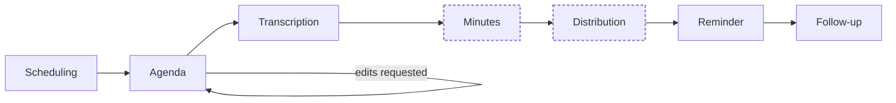

<div align="center">

# Meeting Workflow Engine

**A multi-agent system that schedules, prepares, transcribes, and follows up on meetings, with a human approving everything that goes out.**


[Overview](#-overview) · [Lifecycle](#-lifecycle) · [Design](#-design) · [Safety](#-safety-and-governance) · [Stack](#-tech-stack) · [Getting started](#-getting-started) · [Structure](#-project-structure)

</div>

<br>

## 📅 Overview

Meetings produce a lot of overhead: finding a time, writing an agenda, taking minutes, chasing action items. This project automates that chain with a set of cooperating agents, and keeps a person in control of anything that leaves the system.

An orchestrator plans which agents to run. Each agent acts through tools, the graph checks the validated output, and routing decides what happens next, for example looping back to the agenda when the coordinator requests edits. Progress lives in a shared `MeetingState`, so a run can pause for approval and resume later, even after a restart.

|  |  |
|---|---|
| **Domains** | Agentic AI, LLM applications, NLP, RAG, MLOps, AI safety |
| **Orchestration** | LangGraph state graph with conditional routing and approval interrupts |
| **Tools** | One MCP server for calendar, rooms, speech-to-text, and email |
| **Memory** | ChromaDB retrieval over past agendas, minutes, and decisions |
| **LLM** | Claude API |
| **Backend** | FastAPI, SQLAlchemy, APScheduler |
| **Frontend** | React, Vite, TypeScript |

<br>

## 🔁 Lifecycle



Dashed nodes are approval gates, where the graph pauses until the coordinator resumes it.

| Phase | What happens |
|---|---|
| **Schedule** | Attendee calendars are queried concurrently and merged into ranked time slots. A room is searched and booked. |
| **Prepare** | The agenda is drafted using context retrieved from earlier meetings. Edits loop back for a redraft. |
| **Transcribe** | Meeting audio is transcribed locally with faster-whisper. |
| **Approve** | Minutes are extracted, validated, and held for human approval. Approval also gates distribution. |
| **Track** | Approved action items are stored and monitored. |
| **Follow up** | Reminders escalate from a gentle message, to a nudge, to an alert to the chair. |

<br>

## 🧩 Design

**Shared state.** All agents read and write one typed `MeetingState`. It carries the run from step to step, which is what separates this from a stateless chatbot.

**One capability boundary.** Agents never call external services directly. Every external action goes through a single MCP server (`get_free_busy`, `create_event`, `search_rooms`, `book_room`, and others) as a typed function with a JSON schema. Swapping a tool does not touch the agents.

**Memory.** Short-term context is the `MeetingState`. Long-term context is approved minutes and decisions embedded in ChromaDB with `all-MiniLM-L6-v2` and retrieved before drafting. A `/memory` endpoint exposes the same retrieval as a chat.

**Grounded extraction.** The minutes agent retrieves context, drafts from a grounded prompt, and validates the result with Pydantic. Every decision and action item must carry a source quote and timestamp, and items without a matching quote are rejected.

**Parallelism with fault tolerance.** Calendar lookups run with `asyncio.gather`, then results are intersected. A failed call is logged to `MeetingState.errors` and the merge continues with the data that came back. Distribution sends email and writes the audit log in parallel.

**Observability.** Each node, tool call, prompt, latency, and token count is logged under a shared `trace_id` per run. Logs are served by a `/traces` route to the dashboard. A max-step guardrail stops runaway loops, and nodes retry with exponential backoff (three tries) before falling back.

<br>

## 🛡️ Safety and governance

| Control | How it works |
|---|---|
| **Approval gates** | The graph pauses at minutes and distribution. Only the coordinator role can resume. |
| **PII redaction** | Personal data is redacted before any LLM call. |
| **Audit trail** | Approved artifacts get an immutable record that stores a SHA-256 hash of the approved minutes. |
| **Access control** | JWT authentication with role-based access. |
| **Rollback** | Checkpoints allow a run to return to an earlier state. |
| **Evaluation** | An eval harness measures extraction F1 and transcription word error rate. |

<br>

## 🧰 Tech stack

| Layer | Tools |
|---|---|
| Agents and orchestration | LangGraph, Pydantic, Claude API |
| Tools and integrations | MCP SDK (FastMCP), Google Calendar API, SMTP |
| Speech and retrieval | faster-whisper, sentence-transformers, ChromaDB |
| Backend | FastAPI, SQLAlchemy, Alembic, SQLite / PostgreSQL, APScheduler |
| Frontend | React, Vite, TypeScript |
| Testing and CI | pytest, Playwright, GitHub Actions |
| Deployment | Docker Compose, Render / Railway, Vercel |

<br>

## 🚀 Getting started

Start the backend, database, and ChromaDB together:

```bash
docker compose up
```

Common tasks are wrapped in the Makefile:

```bash
make run
make test
make lint
make migrate
```

Once running, a meeting is driven through the API:

| Endpoint | Purpose |
|---|---|
| `POST /meetings/{id}/start` | Start a run |
| `POST /meetings/{id}/approve` | Resume from an approval gate |
| `GET /traces` | Step-level logs for the dashboard |
| `/memory` | Retrieval chat over past meetings |

The React dashboard shows run status, traces, memory chat, and eval results.

<br>

## 📁 Project structure

```
.
├── backend/app/agents/
│   ├── graph.py             state graph and routing
│   ├── state.py             MeetingState
│   ├── orchestrator.py
│   ├── scheduling.py
│   ├── agenda.py
│   ├── minutes.py
│   ├── distribution.py
│   ├── reminder.py
│   └── follow_up.py
├── mcp_server/
│   ├── server.py            FastMCP instance
│   └── tools/               calendar_tools.py, room_tools.py, ...
├── memory/
│   ├── vector_store.py      store() and retrieve()
│   ├── memory_chat.py
│   └── decision_log.py
├── observability/
│   └── tracer.py
├── core/
│   ├── security.py          JWT and RBAC
│   └── pii.py
├── evals/
│   └── eval_harness.py
├── frontend/                React dashboard
├── tests/
├── docker-compose.yml
├── Makefile
└── docs/                    PRD, Architecture, Design, Phases, Rules
```
